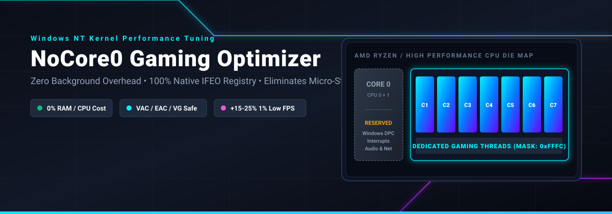

# NoCore0 Gaming Optimizer for Windows

Native Windows process affinity tuner designed to eliminate 1% low frame drops and input stutter by dedicating CPU Core 0 exclusively to operating system DPC interrupts and background tasks, while routing game engines to high-performance cores.



## Features

- **0% Background Overhead**: Implemented strictly via native Windows NT Image File Execution Options (`IFEO`). No resident background services, no RAM usage.
- **Universal Compatibility**: Works with Steam, Epic Games, independent launchers, and direct shortcuts.
- **Anti-Cheat Safe**: Uses standard Windows kernel scheduling parameters (`CpuAffinityMask`). Fully compliant with modern anti-cheat systems.
- **Dynamic Topology Calculation**: Automatically computes the exact affinity bitmask for your specific CPU topology (e.g., `0xFFFC` for 8C/16T processors).
- **Drag-and-Drop Workflow**: Simply drop any game executable or desktop shortcut onto `Game_NoCore0_Manager.bat`.
- **100% Reversible**: Includes instant revert scripts to restore default Windows scheduling.

---

## Technical Principle

On modern multi-core processors, CPU Core 0 (logical processors 0 and 1) handles the majority of system interrupts:
- Network packet processing (NIC DPC)
- Audio rendering and USB polling
- Windows background worker threads

When compute-heavy game threads compete with system interrupts on Core 0, micro-stutters and frame pacing variance occur. By masking Core 0 out of the game's process affinity mask, the Windows kernel schedules the game exclusively across remaining physical cores.

| Architecture | Total Cores / Threads | Windows Affinity Mask | Active Cores |
| :--- | :--- | :--- | :--- |
| **8C / 16T (SMT ON)** | 8 Cores / 16 Threads | `0xFFFC` (`65532`) | Cores 1 - 7 (14 logical threads) |
| **8C / 8T (SMT OFF)** | 8 Cores / 8 Threads | `0x00FE` (`254`) | Cores 1 - 7 (7 physical cores) |
| **6C / 12T (SMT ON)** | 6 Cores / 12 Threads | `0x0FFC` (`4092`) | Cores 1 - 5 (10 logical threads) |

---

## Quick Start

### Method 1: Interactive Manager & Drag-and-Drop
1. Run `Game_NoCore0_Manager.bat` as Administrator.
2. Select `[1]` to configure pre-defined popular titles, or drag and drop any game shortcut directly onto the `.bat` file.

### Method 2: Direct Registry Import
- Import `Preset_30_Games.reg` to configure 30 popular multiplayer titles in one click.
- Import `Restore_Defaults.reg` at any time to return all games to default scheduling.

---

## Project Structure

```text
Game-NoCore0-Optimizer/
├── assets/
│   └── banner.svg               # Vector architecture banner
├── Game_NoCore0_Manager.bat     # Polyglot interactive manager (Drag & Drop)
├── Steam_NoCore0.bat            # Dedicated lightweight Steam launcher
├── Preset_30_Games.reg          # Pre-configured registry preset for 30 titles
├── Restore_Defaults.reg         # 1-click restore to standard Windows affinity
├── LICENSE                      # MIT License
└── README.md                    # Documentation
```

---

## License

This project is licensed under the [MIT License](LICENSE).
