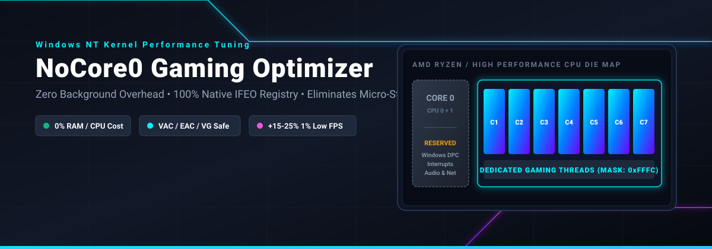

# NoCore0 Gaming Optimizer для Windows

> Нативный оптимизатор соответствия процессора (CPU Affinity) для Windows 10/11. Устраняет микрофризы, просадки 1% Low FPS и снижает задержку ввода за счет полной изоляции Ядра 0 от игрового процесса без сторонних программ в фоне.

🌐 **[English Version](README.md)** • **[Русская версия](README_RU.md)**

---

## ⚡ Быстрый старт (Инструкция для новичка за 30 секунд)

Если вы только что скачали проект и хотите получить максимум FPS без лишней возни:

1. **Распакуйте** скачанный архив `.zip` в любую удобную папку.
2. **Запустите двойным кликом** файл `Game_NoCore0_Manager.bat`.
3. В появившемся окне **нажмите клавишу `1` и затем Enter**.
4. **Всё готово!** 30 популярных онлайн-игр (CS2, GTA V, Fortnite, Dota 2, MTA, ROB RUN и др.) навсегда зарегистрированы в Windows.
5. **Запускайте свои игры абсолютно как обычно** (из библиотеки Steam, лаунчера сервера или ярлыка на рабочем столе). Они сами стартуют на ядрах 1–7 без Ядра 0!

> **Скачали новую игру?** Просто перетащите мышкой её ярлык с рабочего стола на `Game_NoCore0_Manager.bat`. Твик применится за 0.1 секунды!

---

---

## Главные преимущества

- **0% фоновой нагрузки:** Работает через встроенный механизм Windows NT — **Image File Execution Options (IFEO)**. Никаких резидентных служб, фоновых процессов и пожирания ОЗУ.
- **Работает отовсюду:** Твик срабатывает независимо от способа запуска — через Steam, Epic Games, лаунчеры серверов (MTA CCDPlanet, Hassle Online, FaceIT) или обычный ярлык на рабочем столе.
- **100% безопасно для античитов:** Использует штатный параметр ядра Windows `CpuAffinityMask`. Не модифицирует файлы игры, не внедряет DLL и не триггерит VAC, Easy Anti-Cheat, BattlEye или Riot Vanguard.
- **Автоматический расчет топологии:** Скрипт сам определяет количество ядер/потоков и состояние SMT, рассчитывая точную маску (например, `0xFFFC` для 8C/16T процессоров).
- **Удобный Drag-and-Drop:** Просто перетащите ярлык или `.exe` файл любой новой игры на батник — твик применится за 0.1 секунды.
- **100% обратимость:** В комплект входит файл моментального отката всех настроек к стандартным значениям Windows.

---

## В чем суть твика и почему это работает?

В архитектуре процессоров x86-64 и планировщике Windows ядро **Core 0 (логические процессоры CPU 0 и CPU 1)** исторически берет на себя подавляющее большинство аппаратных прерываний системы:
- Сетевой стек (DPC/ISR прерывания сетевой карты)
- Вывод звука и системные таймеры
- Опрос USB-портов (мышь с высокой частотой опроса 1000–8000 Гц, клавиатура)
- Фоновые службы Windows

Когда требовательные потоки игры (особенно рендеринг и симуляция физики) выполняются на том же Ядре 0, они начинают конкурировать с системными прерываниями. Это приводит к разбросу фреймтайма (micro-stutters) и резким просадкам 1% и 0.1% Low FPS.

Исключив Ядро 0 из маски соответствия игры, мы отдаем Ядро 0 полностью под нужды Windows и периферии, а движок игры работает на чистых, ненагруженных ядрах 1–7.

### Таблица расчета масок аффинити

| Процессор | Конфигурация | Маска (Hex) | Десятичное | Выделенные ядра |
| :--- | :--- | :--- | :--- | :--- |
| **8C / 16T (SMT ON)** *(Ryzen 7 9850X3D, 7800X3D, 9700X, 5800X3D)* | 8 ядер / 16 потоков | `0xFFFC` | `65532` | Ядра 1–7 (14 потоков) |
| **8C / 8T (SMT OFF)** *(SMT выключен в BIOS)* | 8 ядер / 8 потоков | `0x00FE` | `254` | Ядра 1–7 (7 физических ядер) |
| **6C / 12T (SMT ON)** *(Ryzen 5 7600X, 9600X, 5600X)* | 6 ядер / 12 потоков | `0x0FFC` | `4092` | Ядра 1–5 (10 потоков) |

---

## Инструкция по использованию

### Вариант 1: Быстрое добавление любой игры (Drag & Drop)
1. Возьмите ярлык игры с рабочего стола или её `.exe` файл.
2. Перетащите его мышкой на файл `Game_NoCore0_Manager.bat`.
3. Окно покажет зеленый статус успешного добавления и закроется. Игра настроена навсегда!

### Вариант 2: Готовый пресет на 30 игр (1 клик)
Запустите файл `Preset_30_Games.reg` от имени Администратора. Он сразу пропишет маску `0xFFFC` для 30 популярных онлайн-хитов:
* **Шутеры и Battle Royale:** Counter-Strike 2, Fortnite, Apex Legends, PUBG, Call of Duty (Warzone), Valorant, Rainbow Six Siege, Overwatch 2, Marvel Rivals, Deadlock, Rust, Escape from Tarkov.
* **MOBA и Онлайн:** Dota 2, GTA V / Online, MTA:SA (включая CCDPlanet), Hassle Online, War Thunder, World of Tanks, Roblox, Rocket League, ROB RUN.
* **Автосимуляторы и песочницы:** BeamNG.drive, Euro Truck Simulator 2, Cyberpunk 2077.

### Вариант 3: Интерактивное меню
Запустите `Game_NoCore0_Manager.bat` двойным кликом:
- `[1]` — Автоматически применить пакет популярных игр
- `[2]` — Выбрать любой `.exe` через стандартное окно «Обзор» проводника
- `[3]` — Ввести имя файла процесса вручную
- `[4]` — Посмотреть список всех активных игр без Ядра 0
- `[5]` — Удалить конкретную игру (вернуть стандартные ядра)
- `[6]` — Полный сброс всех твиков
- `[7]` — Добавить пункт в меню правой кнопки мыши (ПКМ на любой `.exe` -> *"🎮 Запускать без Ядра 0"*)

---

## Как вернуть всё по умолчанию (Откат)
Если вы захотите вернуть стандартное поведение Windows, просто запустите файл `Restore_Defaults.reg`. Он мгновенно удалит все созданные ключи аффинити из реестра.
